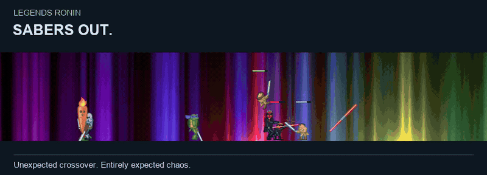

# Legends Ronin

**My action-figure shelf, brought to life on my Mac.**

A playful macOS desktop companion: familiar characters wander, grapple, fly, open portals, and get into tiny crossover fights around your windows. A little 1998. A lot of chaos.

[**Download for Mac — DMG**](https://github.com/doctor-ew/legends-ronin-downloads/releases/latest)

## What it does

- **Mix and match:** add up to 12 guests alongside your selected cast.
- **Desktop playground:** jumping, grappling, window traversal, flight, and portals.
- **Crossovers:** saber duels, blaster exchanges, dodges, and character encounters.
- **Personality:** pizza breaks, pogo hops, gear checks, and other idle antics.
- **Big visitors:** transforming robots, ships, KITT, and the TARDIS.
- **Randomizer:** switch casts automatically every 10–30 minutes.

The cast includes Star Wars and Rebels, the turtles, Rick and Morty, Doctor Strange and Doom, X-Men, G.I. Joe, Lower Decks, Cartoon Planet, and more.

## Requirements

- An **Apple silicon Mac**.
- **macOS 13 or later**.

This build has been tested locally on Apple silicon. Intel Macs and other operating systems are not supported by this package.

## Install

1. Download the `.dmg` from the [latest release](https://github.com/doctor-ew/legends-ronin-downloads/releases/latest).
2. Open it and drag **Legends Ronin** onto **Applications**.
3. Eject the disk image, then open Legends Ronin from Applications.

The app lives in the menu bar. Look for **Legends** at the top of your screen.

**Signing status:** this is an experimental, ad hoc signed build. It is not Developer ID signed or notarized. If macOS blocks the first launch and you choose to trust this download, follow [Apple’s instructions for opening an unnotarized app](https://support.apple.com/en-us/102445). Keep macOS security protections enabled.

## Controls

| Action | How |
| --- | --- |
| Choose a cast | Open the **Legends** menu, or right-click a character |
| Add or remove guests | **Mix & match guests · up to 12** |
| Trigger a special | Give a character a quick click |
| Move a character | Click and drag |
| Start a fight or encounter | **Skirmish now** or **Encounter now** |
| Try a desktop mission | Choose a **Mission** item |
| Rotate casts automatically | Enable **Randomizer: every 10–30 minutes** |
| Reduce CPU use | **Animation frame rate → 30 fps · lower CPU** |
| Prefer smoother animation | **Animation frame rate → 60 fps · smoother motion** |
| Exit | **Quit Legends Ronin** |

Specials vary by character and current activity. Guests can overlap with your main cast. More characters and effects increase CPU use; 30 fps is the default.

## About this build

Legends Ronin is a fan-made character and behavior layer built on the supplied **Klipnok Ronin 1.0.9** desktop engine. Credit for that engine belongs to its original creator. Character names and likenesses belong to their respective owners. This project is not affiliated with or endorsed by those owners.

This public repository contains the README and demo media. Packaged app downloads are attached to [Releases](https://github.com/doctor-ew/legends-ronin-downloads/releases). Source code is not included, and this repository does not grant rights to third-party code or characters.

The release includes a SHA-256 checksum file so you can verify the downloaded disk image. Updates are distributed through this release page.
